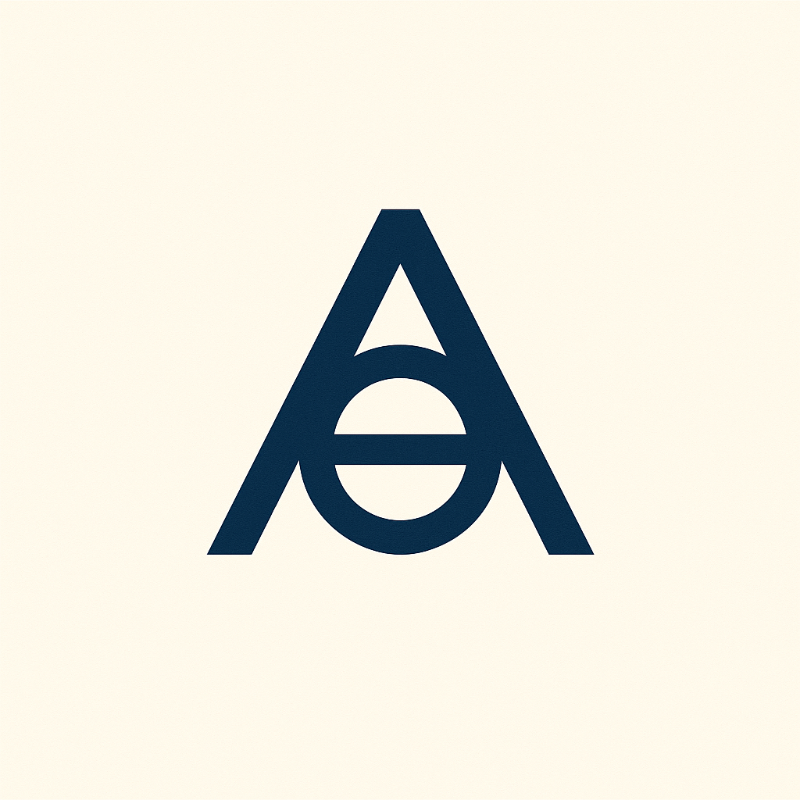
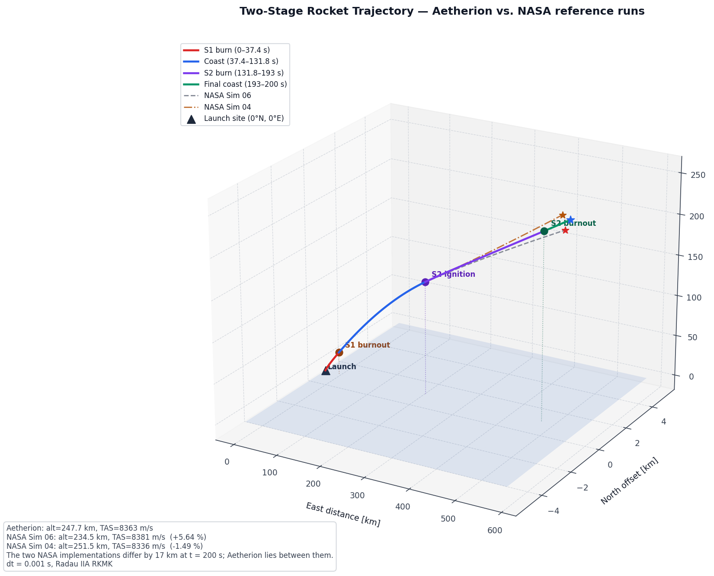
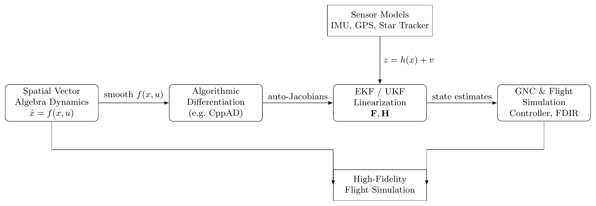
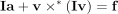

# ΑETHERION — Flight Dynamics Library

[](LICENSE)
[](https://doi.org/10.5281/zenodo.23479182)
[](https://github.com/onurtuncer/Aetherion/actions/workflows/linux.yml)
[](https://github.com/onurtuncer/Aetherion/actions/workflows/windows.yml)
[](https://codecov.io/gh/onurtuncer/Aetherion)
[](https://github.com/onurtuncer/Aetherion/actions/workflows/clang_format.yml)
[](https://github.com/onurtuncer/Aetherion/actions/workflows/cmake_format.yml)
[](https://github.com/onurtuncer/Aetherion/actions/workflows/cmake_lint.yml)
[](https://github.com/onurtuncer/Aetherion/actions/workflows/iwyu.yml)
[](https://github.com/onurtuncer/Aetherion/actions/workflows/clang_tidy.yml)
[](https://onurtuncer.github.io/Aetherion/metrics/)
[](https://github.com/onurtuncer/Aetherion/actions/workflows/sanitizers.yml)
[](https://github.com/onurtuncer/Aetherion/actions/workflows/simulink.yml)
[](https://onurtuncer.github.io/Aetherion/)

<p align="center">
  
</p>

**AETHERION** is a high-precision, research-grade C++ library for **rocket and aerospace flight dynamics**, built on:

- **Featherstone 6-D Spatial Vector Algebra (SVA)**
- **ECI / WGS84 frame transformations**
- **Algorithmic Differentiation (AD-friendly)**
- **Clean ODE formulations for high-fidelity simulation**
- **Lie-group state estimation** (invariant EKF on SE₂(3))

The name *ΑΙΘΕΡΙΟΝ* (Aetherion) is inspired by the Greek word **Αιθήρ**, referring to the upper atmosphere — the pristine realm of celestial motion.

---

## Two-Stage Rocket to Orbit — NASA Validation

The flagship simulation is a full 6-DOF two-stage rocket gravity-turn ascent from the equator, validated against **NASA TM-2015-218675 Atmospheric Scenario 17**. The trajectory below was produced entirely by Aetherion using Featherstone SVA dynamics, the US1976 atmosphere, WGS84 gravity, and an implicit RADAU-IIA integrator.

<p align="center">
  
</p>

Through the first-stage burn and the coast, altitude and speed stay within 0.2 % of the NASA reference runs (Δt = 1 ms). After the second-stage burn the two NASA reference implementations themselves differ by 17 km in altitude and 10° in pitch; Aetherion ends between them: **248 km** against 251 km (Sim 04) and 234 km (Sim 06), **8 363 m/s** against 8 336 and 8 381 m/s.

---

## Features

### Dynamics Core
- **Full 6-DOF rigid-body dynamics** using Featherstone Spatial Vector Algebra
- **ECI equations of motion** — no pseudo-forces, no approximations
- **Air-relative velocity** for aerodynamics; rotating atmosphere handled correctly
- **Variable-mass bodies** — propellant burn, staging events, CG travel

### Numerical Methods
- **Lie-structure-preserving Runge-Kutta-Munthe-Kaas (RKMK) integrators** on SE(3) and product SE(3) × ℝⁿ manifolds
- **Explicit RK4** and **fully implicit RADAU-IIA** schemes (Newton-solved stages) for stiff ascent phases
- **Two-stage Newton-Raphson trim solver** for straight-and-level fixed-wing flight, with aerodynamic moment transfer from the reference centre to the CG

### State Estimation
- **Reference invariant EKF** (`InvariantEKF<S, C>`) on SE₂(3) × ℝ⁷: attitude, velocity and position as one SE₂(3) element, with gyro, accelerometer and barometer biases kept Euclidean
- **Left- or right-invariant error convention** chosen by template parameter, so both filters run on the same models
- **Launch-centred inertial (LCI) navigation frame** with WGS-84 J2 gravity; strapdown process model with a trapezoidal transition matrix
- **GNSS position, GNSS velocity and barometer** measurement models; Joseph-form updates; NEES/NIS consistency metrics
- **Composable state blocks** and a hashed vehicle configuration (`kNavBaroGnss16`), plus a log contract for replaying co-simulation logs
- *(Planned)* replay harness, tuning on the F-16 check cases, float32 rerun, and C code generation of f, h and their Jacobians

See [`doc/sensor_fusion.rst`](doc/sensor_fusion.rst) and [`TODO-sensor-fusion.md`](TODO-sensor-fusion.md) for the design and roadmap.

### Algorithmic Differentiation
- **AD-friendly formulations** throughout — compatible with CppAD, dual numbers, and similar libraries
- **CppAD-taped Jacobians** in the trim solver and the estimator: the process and measurement models tape through Eigen and are checked against finite differences
- *(Planned)* CppADCodeGen export of the estimator Jacobians as plain C

### Environment Models
- **US1976 Standard Atmosphere** (temperature, pressure, density, speed of sound), with ISA + dT and sea-level pressure offsets re-integrated hydrostatically
- **Steady wind and Dryden turbulence (MIL-F-8785C)** on the F-16 and rocket plants, exposed as FMU ports
- **WGS84 gravity model** with ECI/ECEF/geodetic coordinate conversions
- **Branch-free formulations** designed for AD and Kalman filtering

### Aerodynamics & Propulsion
- **DAVE-ML (DML) aerodynamic model loader** — table-driven aero/inertia/propulsion data
- Multi-axis force and moment models; CG-offset spatial inertia
- Stage-aware propellant tracking with automatic separation logic

### Interoperability
- **FMI/FMU export** via fmu4cpp — drop Aetherion plants into any FMI-compliant simulator. Shipped FMUs: `F16Plant`, `F16Autopilot`, `TwoStageRocket` (steady wind, Dryden turbulence and atmosphere offsets exposed as ports)
- **`generateFMU()`** ([`cmake/generate_fmu.cmake`](cmake/generate_fmu.cmake)) packages your own model class as an FMI 2 or FMI 3 FMU — from Aetherion's build tree or from an installed Aetherion found with `find_package(Aetherion)`, which exports the fmu4cpp wrappers and the description generator it needs. [`tests/InstallConsumer`](tests/InstallConsumer) builds one against a relocated installation and steps it under FMPy in CI
- **Simulink models** built from the FMUs by [`matlab/build_f16_simulink.m`](matlab/build_f16_simulink.m) (run in CI) and [`matlab/build_twostagerocket_simulink.m`](matlab/build_twostagerocket_simulink.m)
- JSON configuration files for initial conditions and simulation parameters
- CSV output compatible with NASA reference data formats

### Code Quality
- **Post-modern C++23** design throughout
- Enforces a **practical subset of the JSF AV C++ coding standard**
- CI gates: Clang-Format · CMake-Format · CMake-Lint · IWYU · Clang-Tidy · Metrix++ cyclomatic complexity · AddressSanitizer / UBSan

The two CMake gates share their configuration in [`.cmake-format`](.cmake-format) and cover every
`CMakeLists.txt` and `*.cmake` outside the pruned `build/`, `out/`, `vendor/` and `.venv/`
trees. Reproduce them locally with:

```bash
pip install cmakelang

bash .run-cmake-format   # rewrites listfiles in place; CI fails if this leaves a diff

mapfile -t listfiles < <(
  find . \( -path ./build -o -path ./out -o -path ./vendor -o -path ./.venv \) -prune \
    -o -type f \( -name CMakeLists.txt -o -name "*.cmake" \) -print
)
cmake-lint "${listfiles[@]}" --config-files .cmake-format
```

`--config-files` takes a variable number of arguments, so the listfiles have to come *before* it:
piping them in as `xargs cmake-lint --config-files .cmake-format` makes them look like extra config
files and the run checks nothing at all.

---

## SVA → AD → EKF Pipeline

<p align="center">
  
</p>

The library is architected so that smooth, scalar-templated models feed auto-Jacobians into the filter linearisation, producing a single consistent GNC pipeline from plant model to state estimator. The plant supplies the truth; the estimator's process and measurement models are taped with CppAD, and the reference EKF is the specification that generated flight code will be checked against.

---

## Mathematical Foundations

ΑETHERION implements the full suite of Featherstone spatial constructs:

| Symbol | Meaning |
|--------|---------|
| `v` | Spatial velocity (twist) |
| `a` | Spatial acceleration |
| `I` | Spatial inertia |
| `v×` | Motion cross-product operator |
| `v×*` | Force cross-product operator (adjoint) |

Equation of motion:

<p align="center">
  
</p>

Control surfaces and payload stages can be modelled as rigidly attached bodies within the same spatial algebra.

---

## Frames & Conventions

| Label | Frame |
|-------|-------|
| **W** | Inertial (ECI) |
| **E** | Earth-fixed (ECEF) |
| **B** | Rocket/aircraft body |

All transforms follow:

<p align="center">
  
</p>

notation for spatial transforms, keeping the frame algebra explicit and AD-friendly.

---

## Validated Examples

Each example below runs an atmospheric check case from **NASA TM-2015-218675** (NESC 6-DOF flight simulation check cases). How closely it reproduces the reference runs -- per scenario, per quantity, and against the spread among the NASA implementations themselves, which for some scenarios exceeds Aetherion's difference from any one of them -- is tabulated in the [validation chapter](https://onurtuncer.github.io/Aetherion/examples.html); `scripts/checkpoint_tables.py` regenerates those tables from a run. (`EkfReplay`, a sensor-fusion tool, is not a check case.)

| Example | Vehicle | Scenario |
|---------|---------|----------|
| [`DraglessSphere`](src/Examples/DraglessSphere/DraglessSphere.cpp) | Dragless sphere, gravity only | 1 |
| [`TumblingBrickNoDamping`](src/Examples/TumblingBrickNoDamping/TumblingBrickNoDamping.cpp) | Free tumbling brick | 2 |
| [`TumblingBrickWithDamping`](src/Examples/TumblingBrickWithDamping/TumblingBrickWithDamping.cpp) | Tumbling brick with aerodynamic damping | 3 |
| [`SphereWithAtmosphericDrag`](src/Examples/SphereWithAtmosphericDrag/SphereWithAtmosphericDrag.cpp) | Sphere with atmospheric drag | 6 |
| [`DroppedSphereSteadyWind`](src/Examples/DroppedSphereSteadyWind/DroppedSphereSteadyWind.cpp) | Sphere in steady crosswind | 7 |
| [`DroppedSphere2DWindShear`](src/Examples/DroppedSphere2DWindShear/DroppedSphere2DWindShear.cpp) | Sphere in 2-D wind shear | 8 |
| [`EastwardCannonball`](src/Examples/EastwardCannonball/EastwardCannonball.cpp) | Eastward ballistic cannonball | 9 |
| [`NorthwardCannonball`](src/Examples/NorthwardCannonball/NorthwardCannonball.cpp) | Northward ballistic cannonball | 10 |
| [`F16SteadyFlight`](src/Examples/F16SteadyFlight/F16SteadyFlight.cpp) | F-16 subsonic trimmed flight | 11 |
| [`F16SupersonicTrim`](src/Examples/F16SupersonicTrim/F16SupersonicTrim.cpp) | F-16 supersonic trimmed flight (Mach ≈ 2) | 12 |
| [`F16AltitudeChange`](src/Examples/F16AltitudeChange/F16AltitudeChange.cpp) | F-16 altitude change | 13.1 |
| [`F16AirspeedChange`](src/Examples/F16AirspeedChange/F16AirspeedChange.cpp) | F-16 airspeed change | 13.2 |
| [`F16HeadingChange`](src/Examples/F16HeadingChange/F16HeadingChange.cpp) | F-16 heading change | 13.3 |
| [`F16LateralSideStep`](src/Examples/F16LateralSideStep/F16LateralSideStep.cpp) | F-16 lateral side-step | 13.4 |
| [`CircleNorthPole`](src/Examples/CircleNorthPole/CircleNorthPole.cpp) | F-16 North Pole circumnavigation | 15 |
| [`CircleEquatorDateLine`](src/Examples/CircleEquatorDateLine/CircleEquatorDateLine.cpp) | F-16 circle around equator / date line | 16 |
| [`TwoStageRocket`](src/Examples/TwoStageRocket/TwoStageRocket.cpp) | Two-stage rocket to orbit | 17 |

---

## Testing

- **Catch2 unit tests** covering every module
- **Numerical validation** against the NASA TM-2015-218675 reference runs, scenario by scenario (see the validation chapter for the quantities, tolerances and reference spread)
- **Estimator validation**: Jacobians against finite differences and CppAD; filter consistency (NEES/NIS) in both error conventions on an analytic manoeuvring truth
- **AddressSanitizer + UBSanitizer** run on every CI push
- **Clang-Tidy static analysis** and **IWYU** include hygiene enforced on every PR

---

## Dependencies

| Library | Purpose | Provided by |
|---------|---------|-------------|
| [Eigen](https://eigen.tuxfamily.org) | Linear algebra | vendored (`vendor/eigen`) |
| [CppAD](https://coin-or.github.io/CppAD/) | Algorithmic differentiation | vcpkg (`vcpkg.json`) |
| [nlohmann/json](https://github.com/nlohmann/json) | JSON configuration files | vendored (header-only) |
| [fmu4cpp](https://github.com/markaren/fmu4cpp) | FMI/FMU export | vendored (`vendor/fmu4cpp`) |
| [ecos](https://github.com/Ecos-platform/ecos) | FMI co-simulation engine (FMU smoke testing) | submodule (`vendor/ecos`) |
| [Catch2 v3](https://github.com/catchorg/Catch2) | Unit testing | fetched at configure time |

---

## Documentation

Full API reference and simulation guides are hosted on GitHub Pages:

- [Detailed Documentation](https://onurtuncer.github.io/Aetherion/)

---

## Build & Installation

Clone the repository and initialise submodules:

```bash
git clone https://github.com/onurtuncer/Aetherion.git
cd Aetherion
git submodule update --init --recursive
```

The only submodule, `vendor/ecos`, is used by the test suite alone. A source archive without submodules (a GitHub
release tarball, `git archive`) builds the library, examples and FMUs with `-DAETHERION_BUILD_TESTS=OFF`; with tests on,
configure stops and says to initialise the submodule.

CppAD is consumed through [vcpkg](https://vcpkg.io) on every platform, so a vcpkg clone is
the only external prerequisite:

```bash
git clone https://github.com/microsoft/vcpkg.git ~/vcpkg   # or C:\vcpkg on Windows
~/vcpkg/bootstrap-vcpkg.sh                                 # bootstrap-vcpkg.bat on Windows
export VCPKG_ROOT=~/vcpkg                                  # setx VCPKG_ROOT C:\vcpkg
```

CMake picks the toolchain up from `VCPKG_ROOT` (or `VCPKG_INSTALLATION_ROOT`, which
GitHub-hosted runners already set) and installs the dependencies pinned in `vcpkg.json`
at configure time — no separate `vcpkg install` step. Two caveats:

- `vcvarsall.bat`, and therefore every Visual Studio developer prompt, overwrites
  `VCPKG_ROOT` with the port-less vcpkg stub bundled inside Visual Studio. That stub is
  detected and skipped; if it is the only candidate, pass
  `-DAETHERION_VCPKG_ROOT=<path>` or set `VCPKG_INSTALLATION_ROOT`, which `vcvarsall`
  leaves alone.
- To build against a CppAD that is already installed system-wide, configure with
  `-DAETHERION_USE_VCPKG=OFF` and make sure the prefix is on `CMAKE_PREFIX_PATH`.

### Windows — Visual Studio

1. Open **Visual Studio**
2. **File → Open Folder…** → select the `Aetherion` directory
3. Let Visual Studio configure CMake automatically
4. Choose a configuration (e.g. `x64-Release`)
5. **Build → Build All**

### Linux / macOS — CMake

```bash
cmake -B build -DCMAKE_BUILD_TYPE=Release
cmake --build build --parallel
ctest --test-dir build
```

---

## Citing

If you use Aetherion in your research, please cite it using the metadata in [`CITATION.cff`](CITATION.cff) (GitHub's **Cite this repository** button generates BibTeX and APA from it).

The software is archived on Zenodo under DOI [10.5281/zenodo.23479182](https://doi.org/10.5281/zenodo.23479182), which always resolves to the latest release; each release also has its own version DOI, listed on the Zenodo record.

---

## Community

- **Bug Tracker**: [GitHub Issues](https://github.com/onurtuncer/Aetherion/issues)
- **Discussions**: [GitHub Discussions](https://github.com/onurtuncer/Aetherion/discussions/)

---

## Author

**Prof. Dr. Onur Tuncer**  
Aerospace Engineer, Researcher & C++ Systems Developer  
Istanbul Technical University · [onur.tuncer@itu.edu.tr](mailto:onur.tuncer@itu.edu.tr)

<p align="left">
  
</p>
